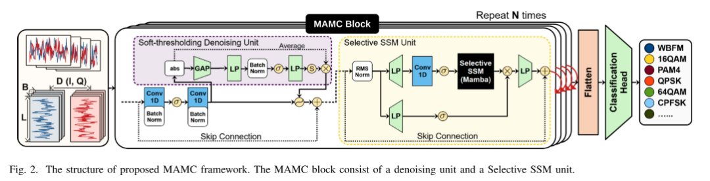
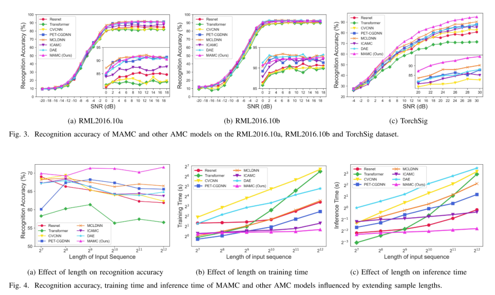

# [Modulation Identification] MAMC - The Best Choice for Auto-modulation Classification Accuracy and Efficiency with Extended Signal Lengths [with code included]

Introduction In the field of modern communication systems, Automatic Modulation Classification (AMC) has emerged providing fundamental functionalities for applications such as spectrum monitoring, electronic warfare, and adaptive communication systems [1]. The push towards more intelligent and agile communication systems has accelerated research on AMC methods, particularly in deep neural networks [2]
In the exploration of deep learning-driven AMC, researchers have adopted models such as Convolutional Neural Networks (CNN), Recurrent Neural Networks (RNN), and Transformer. Simple raw models struggle to adapt to variable signals, leading to reduced accuracy. Researchers have combined complex modules to improve accuracy, but this also increases computational time and memory usage [3]-[5]
At the same time, with the increasing number of Internet of Things (IoT) devices, limited computing power is emphasized along with urgency [6]. Efficiency becomes a critical metric. Previous studies have achieved high urgency and low memory usage by significantly reducing model complexity, which can affect accuracy [6]-[8]. Accuracy and efficiency present a contradictory relationship, where powerful models require higher computational costs.
Moreover, an often overlooked challenge is that public datasets often contain shorter sampling lengths, as shown in RML 2016.10 [9]. The number of symbols is constrained, and may not reach actual counts in certain modulation schemes. Despite this, current models rarely verify robustness for longer sequences. As shown in Figure 1, due to the impact of signal length extension, we aim to develop a model that ensures recognition accuracy while ensuring both time and memory efficiency.
The emerging models that meet these stringent requirements are Selective State Space Models (SSM), also known as Mamba [10]. Mamba selectively propagates information based on the current input and models historical information, thereby enhancing long-term memory. Mamba ensures rapid inference capabilities of recurrent models and high-speed parallel training capabilities of convolutional models, further accelerating the training process by reducing GPU memory swaps. Mamba has extremely low computational and storage overheads along with high throughput.
In this letter, we propose an Auto-Modulation Classification (MAMC) method based on Mamba. We introduce a denoising capability in convolutional units to improve the model's adaptability under different signal-to-noise ratios (SNR) and combine Mamba to achieve accurate and efficient AMC. The contributions of this letter are as follows:
·We first introduce Mamba into AMC and contribute to the community through open source code. This initiative establishes a new benchmark in the AMC field and promotes further research.
·We conduct a thorough study on the impact of extending signal sample lengths in AMC. The proposed MAMC framework possesses denoising and time-dependent capabilities, offering better robustness for longer sequences.
·Our MAMC framework demonstrates optimal performance. Compared to existing models, it consistently provides superior accuracy, reduces computation time and memory usage, and maintains stable performance across signal lengths and SNR spectrums.
Conclusion In this letter, we propose a new AMC for the MAMC model, which enhances accuracy and efficiency with extended signal lengths by integrating selective SSM and denoising units. Experimental results on multiple datasets demonstrate that compared to existing models, the MAMC model not only achieves higher accuracy but also has lower time and space overheads, thereby achieving higher throughput. Furthermore, MAMC shows improved robustness on longer sequences. These findings indicate that MAMC holds greater application value in a broader range of Internet of Things scenarios. Future work will include better utilization of SSM within the AMC to further improve the accuracy, timeliness, and robustness of extending signal durations.

## Images

<!-- PAYMENT_BLOCK -->

## Get this dataset

- Payment link (Stripe): [Buy now](https://buy.stripe.com/3cs8yP7sY87d0vu9AB)
- Payment QR code: 

<!-- /PAYMENT_BLOCK -->
